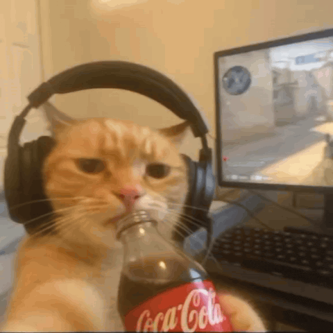

# Sobre mim

Olá! Meu nome é Arthur Santana, tenho 11 anos e sou estudante de programação.

No momento, estou estudando HTML5 e CSS3. No futuro, quero estudar JavaScript e React.

Gosto muito de criar sites e fazer vários projetos!

